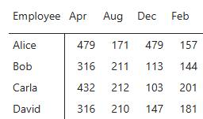
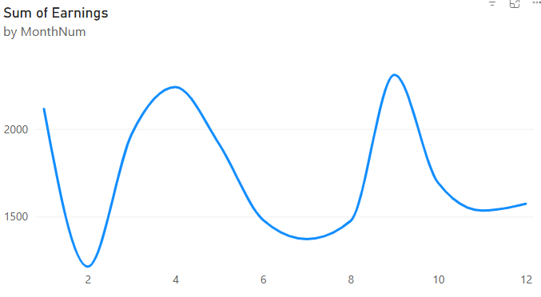
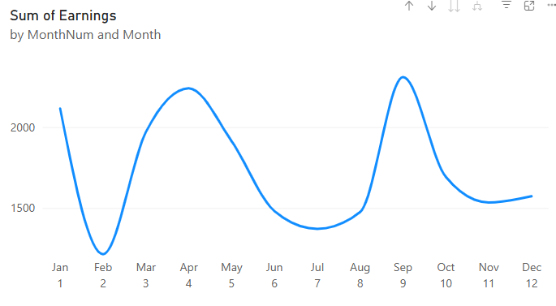

### What is DAX?
Part of learning PowerBI is learning to write Data Analysis Expressions (DAX).
DAX is essentially a scripting language for defining how data should be calculated/represented in PowerBI's Visuals.

In my week-long experience with PowerBI, the two most important use-cases for writing DAX seem to be for (1) deriving new Tables from existing ones, and (2) defining Measures. Before explaining Measures it's best to explain how a Visual is calculated.

### How are Visuals calculated?
Essentially, a Visual consists of a number of "cells"[^1], each cell is defined by the intersection[^2] of Columns/Rows/Values/etc. that have been placed into the Visual.
Suppose we have a Table "employee_earnings" with columns "Employee", "Month", "Earnings":

| Employee | Month | Earnings |
| -------- | ----- | -------- |
| Alice    | Jan   | 427      |
| Alice    | Feb   | 157      |
| ...      | ...   | ...      |
| Farid    | Dec   | 438      |

Suppose we define a matrix Visual with Employee on the rows, Month on the columns, and Earnings as the "values".



PowerBI will attempt to build up the visual from each cell's[^3] **Filter context**. The **Filter context** for any cell in the matrix is defined by what we've put on the rows and columns, therefore the top-left cell's Filter context is: 

```DAX
(employee_earnings[Employee] = "Alice" && employee_earnings[Month] = "Apr").  
```

To calculate the value on this location, PowerBI passes this Filter Context to the **Measure** we've defined for "Values". We haven't actually defined a Measure, we've placed "Earnings" onto values, which PowerBI automatically converted into the measure:

```DAX
SUM(employee_earnings[Earnings])
```

When PowerBI takes the SUM over Earnings, the Filter context defined above is first applied to the employee_earnings Table. The following code snippet approximates the logic:

```java
var filter_context = (employee_earnings[Employee] = "Alice" && employee_earnings[Month] = "Apr"); // Create boolean mask over table
var filtered_table = employee_earnings[filter_context]; // Apply a boolean mask to the table
RETURN SUM(filtered_table[Earnings]);
```
Since the combination Employee + Month is unique in our Table, 'filtered_table' will contain only a single row. The SUM over all rows in the column [Earnings] therefore becomes equal to '479'.

Two important notes about measures. First, a measure is dependent on the Filter context it's given, different Filter contexts will produce different values.
Second, this means that a measure is calculated ONLY when it is requested by a Visual it's been placed on, it cannot be shown in a Table. In order to test a measure we have to create a basic Visual such as the one defined above which provides a Filter context.

### Creating new columns
Suppose we don't like "Jan", "Feb", "Mar", etc. for our Months column and we'd like numbers from 1 to 12 for ordering purposes. We can define a new column by selecting our table and clicking "Add new Column", this lets us write a DAX expression in **Row context**, row context differs from Filter context in that the input to the DAX are all values in a row. Simply put, we create a new column by calculating a value from each row.

We can define a new column MonthNum like so:
```SQL
MonthNum = 
SWITCH(
    [Month],
    "Jan", 01,
    "Feb", 02,
    "Mar", 03,
    "Apr", 04,
    "May", 05,
    "Jun", 06,
    "Jul", 07,
    "Aug", 08,
    "Sep", 09,
    "Oct", 10,
    "Nov", 11,
    "Dec", 12,
    -1
 )
```
Here, for each row, the value on the column "Month" is taken as input for the SWITCH statement.
Let's make a line graph showing the earnings each month. We put MonthNum on the X-axis, and Earnings on the Y-axis.



This looks okay but we'd like to reintroduce the Month names, but keep the ordering. 
There are two ways simple ways, (1) simply add Month too the X-axis as well:



(2) Add MonthNum to the table directly using Power Query. Then we can add month to the X-axis and sort Month by MonthNum[^4], which is left as an exercise to the reader.


[^1]: Cell is not an official PowerBI term, but Claude likes it and I'm willing to bend the knee to my AI overlord on this topic.

[^2]: The mathematically-inclined can imagine each cell to defined by the Cartesian product of Columns/Rows, where the value of the cell then is calculated by a function taking the cell's (col_value, row_value) as input.

[^3]: Here a matrix cell corresponds 1-to-1 to a Visual's "calculation" cell

[^4]: We cannot sort Month on the MonthNum column we calculated with DAX, because the value in the MonthNum column is defined by the value in Month.
